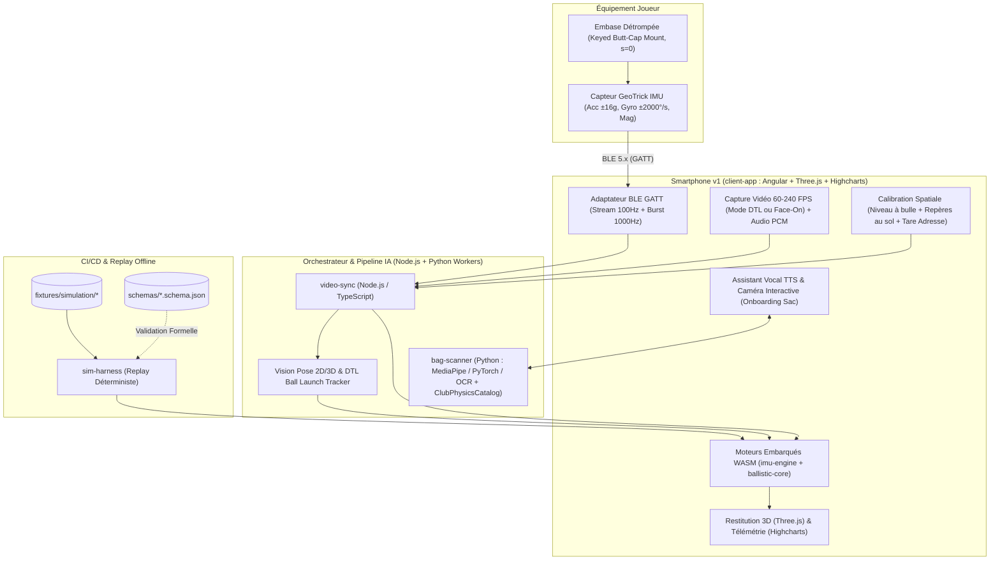

# 00 — Architecture Globale & Gouvernance Système (Kinetra)

- **Statut :** Normatif (Phase 1 — SDD)
- **Version :** 1.0.0
- **ADRs liés :** [ADR-0001](../docs/adr/0001-sdd-normative-ears-and-json-schema.md), [ADR-0002](../docs/adr/0002-rust-wasm-deterministic-physics-core.md), [ADR-0003](../docs/adr/0003-single-smartphone-v1-and-16g-impact-signature.md)
- **Glossaire de référence :** [GLOSSARY.md](../GLOSSARY.md)

---

## 1. Vision & Principes Directeurs

**Kinetra** est une plateforme d'analyse biomécanique et balistique du swing de golf combinant :
1. **Un capteur inertiel externe (`GeoTrick IMU`)** monté au sommet du grip (*butt cap*, $s = 0$) via une embase mécanique à détrompeur unique (**`Keyed Butt-Cap Mount`**), exploitant volontairement la saturation de son accéléromètre $\pm 16\,g$ lors de l'onde de choc d'impact ($\ge 20\,g$) ainsi que le gyroscope axial ($\Delta \omega_z$) et la vibration résiduelle (*ring-down*) pour détecter la frappe, localiser le point d'impact sur la face (`heel`, `center`, `toe`) et calculer l'orientation compensée de la face (**`Compensated Clubface Orientation`**) selon le matériau (`steel` vs `graphite`) et le flex du shaft.
2. **Une capture vidéo intelligente sur Smartphone unique en v1 (`Single-Camera Session`)**, positionné au choix en vue **`DTL` (Down-The-Line, par défaut)** ou **`Face-On`**, synchronisée à la milliseconde ($\le \pm 2\text{ ms}$) avec le capteur IMU via l'**`Impact Sync Anchor`** (pic acoustique d'impact + onde de choc IMU), tout en restant nativement extensible à une configuration bi-caméra (`dual_camera`) en v2.
3. **Un assistant interactif d'initialisation du sac (`bag-scanner`)** piloté par consignes vocales (TTS) et reconnaissance vidéo en continu (Vision + OCR + catalogue mécanique `ClubPhysicsCatalog`).
4. **Un moteur balistique 3D déterministe (`ballistic-core`)** fusionnant les données IMU et vidéo DTL, gérant les écarts entre balle de practice (`range_ball`) et balle de parcours (`tour_ball`), ainsi que les entraînements sans balle (**`Dry Swing`**).
5. **Un harnais de simulation (`sim-harness`)** permettant de rejouer de manière 100 % déterministe des swings enregistrés (`fixtures/simulation/`) en CI/CD sans matériel physique.

---

## 2. Topologie Système & Flux Temps Réel

---

## 3. Référentiel Spatial & Conventions de Coordonnées 3D

Afin d'éliminer toute ambiguïté entre les modules Rust (`imu-engine`, `ballistic-core`), Python (`bag-scanner`, pose 3D) et TypeScript (`video-sync`, `client-app` Three.js), Kinetra impose deux repères orthonormés directs (règle de la main droite, unités SI) :

### 3.1 Repère Monde Terrain ($\mathcal{R}_{\text{world}} = (O_{\text{ball}}, \vec{X}_w, \vec{Y}_w, \vec{Z}_w)$)
- **Origine $O_{\text{ball}} = (0, 0, 0)$** : Centre de la balle à l'adresse (ou point d'adresse de la tête de club en mode `Dry Swing`).
- **Axe $\vec{X}_w$ (Cible / Target Line)** : Horizontal, dirigé de la balle vers la cible visée ($+\vec{X}_w$).
- **Axe $\vec{Y}_w$ (Latéral / Toe-Line)** : Horizontal, perpendiculaire à la ligne de jeu, dirigé de la balle vers l'avant du joueur (pour un droitier, du joueur vers la balle : $+\vec{Y}_w$ pointe vers la droite de la cible ; déviation latérale positive = *push/slice* à droite).
- **Axe $\vec{Z}_w$ (Vertical / Zénith)** : Vertical ascendant, opposé au vecteur gravité $\vec{g} = (0, 0, -9.80665\text{ m/s}^2)$.

### 3.2 Repère Local Club & Capteur Butt-Cap ($\mathcal{R}_{\text{club}} = (O_{\text{butt}}, \vec{x}_c, \vec{y}_c, \vec{z}_c)$)
- **Origine $O_{\text{butt}}$ ($s = 0$)** : Centre géométrique de la masse sensible du capteur **GeoTrick IMU** verrouillé dans la **`Keyed Butt-Cap Mount`** au sommet du grip.
- **Axe $\vec{z}_c$ (Axial Shaft)** : Aligné avec l'axe longitudinal du shaft, dirigé de la tête de club vers le sommet du grip ($s = 0$) ; la tête de club se situe donc à l'abscisse curviligne $s = L_{\text{club}}$ selon $-\vec{z}_c$.
- **Axe $\vec{x}_c$ (Normale Face / Leading Edge Normal)** : Perpendiculaire à l'axe du shaft et mécaniquement indexé par le détrompeur de l'embase dans la direction normale à la face de club (pointant vers la cible lorsque la face est *square* à l'adresse).
- **Axe $\vec{y}_c$ ($\vec{z}_c \times \vec{x}_c$ — Axe Toe-to-Heel)** : Dans le plan de la face, dirigé de la pointe (*toe*) vers le talon (*heel*) pour un club droitier.

---

## 4. Stack Technique Normative

| Module (`src/`) | Langage & Runtime | Responsabilité Normative | Contrats associés (`schemas/`) |
| :--- | :--- | :--- | :--- |
| `src/imu-engine` | **Rust 2024 (`rustc 1.92+`)** compilé en natif (`.so`/`.a`) et WebAssembly (`wasm32-unknown-unknown`) | Décodage trames BLE GeoTrick, tare d'adresse, détection d'impact par écrêtage $\pm 16\,g$, localisation de frappe (`heel`/`center`/`toe`) via $\Delta \omega_z$ & *ring-down*, modèle élastodynamique Euler-Bernoulli + torsion (Acier vs Graphite), calcul de `Compensated Clubface Orientation`. | `imu-telemetry.schema.json`, `club-profile.schema.json` |
| `src/ballistic-core` | **Rust 2024 (`rustc 1.92+`)** compilé en natif et WebAssembly | Fusion hybride IMU + fenêtre vidéo DTL, gestion du mode `Dry Swing`, solveur aérodynamique RK4 6-DDL ($\Delta t = 1\text{ ms}$) avec effet Magnus, vent 3D, rebond/roule et profils `tour_ball` vs `range_ball`. | `ballistic-trajectory.schema.json`, `ball-profile.schema.json` |
| `src/video-sync` | **TypeScript (Node.js 24)** + `ffmpeg` | Gestion de session v1 mono-smartphone (`dtl` ou `face_on`) extensible v2 `dual_camera`, calibration spatiale, détection du transitoire acoustique d'impact et alignement milliseconde sur l'`Impact Sync Anchor`. | `video-sync-session.schema.json` |
| `src/bag-scanner` | **Python 3.11+** (PyTorch / MediaPipe / OpenCV / OCR) | Machine à états d'onboarding interactif guidé à la voix (TTS) + flux vidéo continu, reconnaissance club/shaft, résolution dans `ClubPhysicsCatalog`. | `bag-scanner.schema.json`, `club-profile.schema.json` |
| `src/sim-harness` | **TypeScript / Rust CLI** | Exécuteur déterministe de scénarios `fixtures/simulation/*`, validation JSON Schema Draft 2020-12 et vérification des tolérances numériques en CI/CD. | `simulation-fixture.schema.json` |
| `src/client-app` | **React Native (JSI C++ / TypeScript) + Skia 120Hz + VisionCamera v4 + Three.js (`@react-three/fiber`) + IA Locale On-Device (MediaPipe/LiteRT + Sherpa-ONNX/Whisper)** | Application mobile native Android & iOS ultra-fluide ($120\text{ Hz}$) exécutant en local les moteurs Rust (`.so`/`.a` FFI), la vision live $60\text{–}240\text{ FPS}$, l'interaction vocale STT/TTS hors-ligne, la jauge batterie/charge BLE et le rendu 3D. | Tous les schémas `schemas/*.schema.json` |

---

## 5. Exigences Normatives d'Architecture (Syntaxe EARS)

### `REQ-ARCH-001` — Topologie v1 Mono-Smartphone & Extensibilité v2
> **When** une session de capture est initialisée en v1 (`Single-Camera Session`), **the system shall** opérer avec un seul smartphone connecté en BLE au capteur GeoTrick IMU et configuré soit en mode `dtl` (par défaut), soit en mode `face_on`, tout en acceptant dans le contrat `video-sync-session.schema.json` un tableau de flux caméras de cardinalité $1$ (v1) ou $2$ (v2 `dual_camera`) sans modification de schéma.

### `REQ-ARCH-002` — Déterminisme Mathématique Multi-Plateforme
> **While** les moteurs `imu-engine` et `ballistic-core` traitent un même jeu de données d'entrée conforme à `simulation-fixture.schema.json`, **the system shall** produire des sorties numériques identiques à $\le 10^{-6}$ près en virgule flottante IEEE-754 `f64`, que le code soit exécuté en binaire natif Linux x86_64/ARM64 (CI `sim-harness`) ou en module WebAssembly dans `client-app`.

### `REQ-ARCH-003` — Validation Stricte des Contrats par Schéma
> **When** un message ou dataset traverse la frontière entre deux modules (`imu-engine`, `ballistic-core`, `video-sync`, `bag-scanner`, `sim-harness`, `client-app`), **the system shall** valider sa conformité au schéma JSON Draft 2020-12 correspondant dans `schemas/` et rejeter immédiatement toute charge utile non conforme avec un code d'erreur typé.

### `REQ-ARCH-004` — Gouvernance SDD Zéro Dérive
> **If** une modification fonctionnelle ou physique est proposée sur un module, **then the system shall** exiger la mise à jour préalable de l'exigence `REQ-*` dans `specs/`, du contrat dans `schemas/` et du scénario dans `fixtures/simulation/` avant toute modification dans `src/`.

---

## 6. Matrice Globale des Documents Normatifs

| Document | Domaine couvert | Identifiants d'exigences | Schémas principaux |
| :--- | :--- | :--- | :--- |
| [00-architecture.md](./00-architecture.md) | Topologie, repères 3D, déterminisme, gouvernance SDD | `REQ-ARCH-001` à `REQ-ARCH-004` | `simulation-fixture.schema.json` |
| [01-hardware-imu-shaft.md](./01-hardware-imu-shaft.md) | GeoTrick IMU Butt-Cap, embase détrompée, écrêtage $16\,g$, torsion/flexion shaft | `REQ-IMU-001` à `REQ-IMU-009` | `imu-telemetry.schema.json`, `club-profile.schema.json` |
| [02-video-sync-calibration.md](./02-video-sync-calibration.md) | Vidéo 60+ FPS, calibration spatiale, synchronisation `Impact Sync Anchor` | `REQ-SYNC-001` à `REQ-SYNC-007` | `video-sync-session.schema.json` |
| [03-bag-scanner-ai.md](./03-bag-scanner-ai.md) | Onboarding interactif vocal & vidéo, OCR shaft/tête, `ClubPhysicsCatalog` | `REQ-BAG-001` à `REQ-BAG-006` | `bag-scanner.schema.json`, `club-profile.schema.json` |
| [04-ballistic-engine.md](./04-ballistic-engine.md) | Fusion IMU+DTL, RK4 6-DDL, Magnus, `tour_ball` vs `range_ball`, `Dry Swing` | `REQ-BAL-001` à `REQ-BAL-008` | `ballistic-trajectory.schema.json`, `ball-profile.schema.json` |
| [05-simulation-harness.md](./05-simulation-harness.md) | Replay CI/CD déterministe, tolérances d'acceptation, datasets de référence | `REQ-SIM-001` à `REQ-SIM-005` | `simulation-fixture.schema.json` |
| [06-api-contracts.md](./06-api-contracts.md) | Bus d'événements temps réel, FFI/WASM, erreurs standardisées | `REQ-API-001` à `REQ-API-005` | Tous (`schemas/*.schema.json`) |
