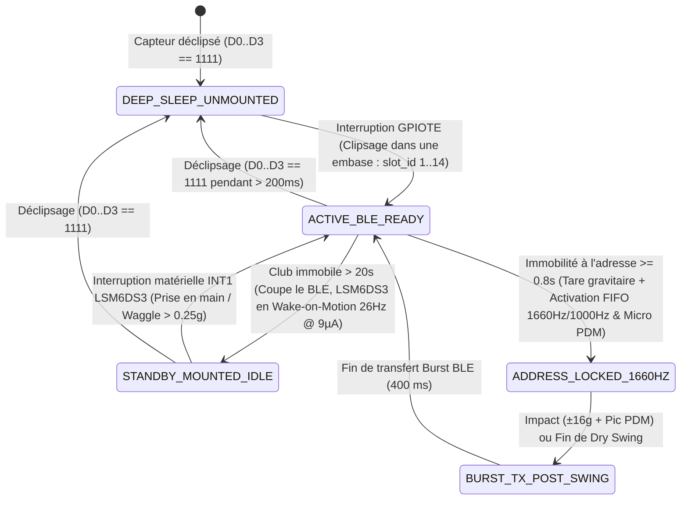

# 01 — Spécification Matérielle GeoTrick IMU (XIAO BLE nRF52840 Sense), Embase Auto-ID 4-Bits, Gestion d'Énergie Wake-on-Use & Compensation Dynamique du Shaft (`imu-engine`)

- **Statut :** Normatif (Phase 1 — SDD)
- **Version :** 1.1.0
- **Module cible :** `src/imu-engine` (Rust natif & WebAssembly) + Firmware C/Rust `nRF52840`
- **Schémas associés :** [imu-telemetry.schema.json](../schemas/imu-telemetry.schema.json), [club-profile.schema.json](../schemas/club-profile.schema.json)
- **ADRs liés :** [ADR-0002](../docs/adr/0002-rust-wasm-deterministic-physics-core.md), [ADR-0003](../docs/adr/0003-single-smartphone-v1-and-16g-impact-signature.md), [ADR-0004](../docs/adr/0004-xiao-nrf52840-sense-gpio-mount-id-and-ulp-wake.md)

---

## 1. Nomenclature Matérielle Réelle (BOM) & Montage Sommet du Grip ($s = 0$)

### 1.1 Liste des Composants Matériels du Capteur GeoTrick IMU
| Référence / Code | Composant | Rôle et Caractéristiques Physiques |
| :--- | :--- | :--- |
| **`102010469` (Code 37557)** | **Carte Seeed Studio XIAO BLE nRF52840 Sense** | MCU Nordic `nRF52840` (ARM Cortex-M4F $64\text{ MHz}$, $1\text{ Mo}$ Flash, $256\text{ Ko}$ RAM, BLE 5.0 2M PHY) + IMU 6-DoF **`LSM6DS3TR-C`** ($\pm 16\,g$, $\pm 2000^\circ/\text{s}$, jusqu'à $1.66\text{ kHz}$) + Micro numérique PDM **`MP34DT05-A`** + Chargeur LiPo `BQ25101` ($21 \times 17.5\text{ mm}$, $2.0\text{ g}$). |
| **`L301525` (Code 09958)** | **Accu LiPo $3,7\text{ V } 85\text{ mAh}$** | Dimensions $30 \times 15 \times 2.5\text{ mm}$ ($\sim 2.2\text{ g}$), soudé sur les pads `BAT+` / `BAT-` au dos de la XIAO, rechargé par le port USB-C de la XIAO. |
| **`ESP101` (Code 07179)** | **Inverseur unipolaire miniature ON-ON** | Coupure physique maître de la ligne `BAT+` pour le transport longue durée ($500\text{ mA} / 12\text{ Vcc}$, $0.8\text{ g}$). |
| **`FC25J` / `FC25V` + `FTK01`** | **Fils souples $0,20\text{ mm}^2$ & Gaine thermo** | Câblage interne batterie/interrupteur et réalisation des ponts de codage binaire 4 bits (`D0..D3` vers `GND`) dans chaque embase de club. |

> [!TIP]
> **Recommandation d'ajout matériel ($< 10\text{ €}$) pour fiabiliser les 14 embases :**
> Afin d'éviter toute usure ou faux contact des fils lors des clipsages répétés entre clubs, il est recommandé d'utiliser un **connecteur à pistons dorés sur ressort (*Pogo Pins* 5 broches à pas de $2.0\text{ mm}$ ou $2.54\text{ mm}$)** :
> - **1 barrette mâle 5 Pogo Pins** montée sous le boîtier du capteur XIAO (reliée à `D0`, `D1`, `D2`, `D3`, `GND`).
> - **14 cibles femelles (5 pastilles dorées planes)** intégrées dans les 14 embases de clubs, au dos desquelles vos fils souples `FC25J`/`FC25V` réalisent les ponts vers `GND`.

---

## 2. Embase à Détrompeur Mécanique & Auto-Identification Électrique 4-Bits (`Keyed Butt-Cap Mount`)

### 2.1 Détrompeur Mécanique à Sens Unique
L'embase fixée au sommet du grip ($s = 0$) possède une empreinte asymétrique en « D » qui oblige le capteur à s'insérer dans **un seul sens unique** ($\text{jeu angulaire} \le \pm 0.25^\circ$), alignant l'axe $+\vec{x}_c$ du capteur `LSM6DS3TR-C` avec le bord d'attaque (*leading edge*) de la face du club.

### 2.2 Codage Binaire Passif sur 4 Broches GPIO (`D0..D3` + `GND`)
Le microcontrôleur `nRF52840` configure ses 4 broches digitales `D0`, `D1`, `D2`, `D3` en entrée avec résistances de tirage internes activées (`GPIO_PIN_CNF_PULL_Pullup`, $\sim 13\text{ k}\Omega$ vers $V_{DD}$).
Dans chaque embase de club, un câblage passif relie un sous-ensemble de ces 4 plots au plot `GND` (`0` logique = relié à `GND`, `1` logique = laissé flottant) :

$$\text{Code\_Brut} = (b_3 b_2 b_1 b_0)_2 \in \{0..15\}, \qquad \text{mount\_slot\_id} = 15 - \text{Code\_Brut}$$

| État / Emplacement Sac | Broches reliées à `GND` dans l'embase | Lecture GPIO `(D3, D2, D1, D0)` | `mount_slot_id` décodé | Usage |
| :--- | :--- | :--- | :--- | :--- |
| **Capteur Déclipsé** | Aucune (circuit ouvert) | `1111` ($15$) | **`0` (`UNMOUNTED`)** | Coupe le BLE et place le XIAO en `DEEP_SLEEP_UNMOUNTED`. |
| **Embase Club #1** | `D0` $\rightarrow$ `GND` | `1110` ($14$) | **`1`** | Ex. Driver (`1W`) |
| **Embase Club #2** | `D1` $\rightarrow$ `GND` | `1101` ($13$) | **`2`** | Ex. Bois 3 (`3W`) |
| **Embase Club #3** | `D1, D0` $\rightarrow$ `GND` | `1100` ($12$) | **`3`** | Ex. Hybride (`4H`) |
| **...** | ... | ... | **`4` à `13`** | Fers `4I` à `PW`, Wedges |
| **Embase Club #14** | `D3, D2, D1` $\rightarrow$ `GND` | `0001` ($1$) | **`14`** | Ex. Putter / Lob Wedge (`60°`) |

Dès que le joueur déplace le capteur d'un club à un autre, le XIAO lit le nouveau `mount_slot_id` après un anti-rebond matériel de $50\text{ ms}$ et notifie immédiatement le smartphone en BLE : **l'application sélectionne automatiquement le `Club Profile` correspondant sans aucune saisie manuelle**.

---

## 3. Gestion d'Énergie Ultra-Basse Consommation (`Wake-on-Use Power Mode`)

Afin de maximiser l'autonomie de l'accu LiPo **$85\text{ mAh}$ (`L301525`)**, la radio BLE et l'acquisition haute fréquence ne sont activées **que lorsque le club est effectivement utilisé** :

### Bilan Énergétique sur Accu LiPo $85\text{ mAh}$
| État de la Machine d'Énergie | Radio BLE | État `LSM6DS3TR-C` & Micro `MP34DT05-A` | Courant Typique | Autonomie Équivalente |
| :--- | :--- | :--- | :--- | :--- |
| **`DEEP_SLEEP_UNMOUNTED`** | **OFF (0 mA)** | Power-Down + Surveillance `GPIOTE PORT` sur `D0..D3` | **$\sim 15\,\mu\text{A}$** | $> 6\text{ mois}$ en veille |
| **`STANDBY_MOUNTED_IDLE`** *(Club posé ou dans le sac)* | **OFF (0 mA)** | Accel Ultra-Low-Power $26\text{ Hz}$ (Interruption matérielle `INT1` si $\|a - 1g\| > 0.25\,g$), Gyro OFF, Micro OFF | **$\sim 25\,\mu\text{A}$** | $> 3\text{ mois}$ en veille sur club |
| **`ACTIVE_BLE_READY`** *(Club en main / Waggle)* | **ON ($100\text{ Hz}$ Notify)** | IMU $104\text{ Hz}$ (détection de mise à l'adresse), Micro OFF | **$\sim 4.2\text{ mA}$** | $\sim 20\text{ h}$ en continu |
| **`ADDRESS_LOCKED` & `BURST_TX`** *(Fenêtre de $3\text{ s}$ du swing)* | **ON (2M PHY Burst)** | IMU $1660\text{ Hz}$ (décimé/interpolé à $1000\text{ Hz}$) + Micro PDM $16\text{ kHz}$ actif | **$\sim 12.5\text{ mA}$** | **$> 30\text{ heures}$ de jeu réel** ($\sim 10$ parcours de 18 trous) |
| **`USB_CHARGING_TELEMETRY`** *(Câble USB-C branché)* | **ON ($1\text{ Hz}$ Notify)** | IMU OFF, Micro OFF, Lecture ADC `PIN_VBAT` (`P0.31`) + Statut `BQ25101` (`P0.17`) | Alimenté par USB-C ($50\text{ mA}$ charge) | Temps réel pendant toute la charge ($\sim 1\text{ h }40$ de $0$ à $100\%$) |

> [!IMPORTANT]
> **Désactivation des Pull-Ups pendant l'état monté :** Pour éviter qu'un plot relié à `GND` dans l'embase ne consomme inutilement $\frac{3.3\text{ V}}{13\text{ k}\Omega} \approx 250\,\mu\text{A}$ en permanence, le firmware `nRF52840` lit l'état de `D0..D3` en $50\,\mu\text{s}$ (pull-ups activés uniquement pendant l'échantillonnage toutes les $250\text{ ms}$ en veille) puis repasse les broches à `GND` sans pull-up entre deux lectures.

### 3.1 Suivi de l'État de la Batterie & de l'Avancement de la Charge (`BQ25101` + `PIN_VBAT`)
La carte XIAO BLE nRF52840 Sense intègre nativement trois circuits dédiés à la gestion de l'accu LiPo `L301525` ($85\text{ mAh}$) :
1. **Configuration du Courant de Charge à $50\text{ mA}$ (`P0.13` = HIGH)** :
   Pour préserver la santé de l'accu LiPo $85\text{ mAh}$ ($\le 0.6\,\text{C}$), la broche de contrôle de courant du chargeur `BQ25101` (`P0.13`) est maintenue en mode **$50\text{ mA}$** (et jamais $100\text{ mA}$).
2. **Mesure de Tension Sans Consommation Parasite (`P0.14` + `P0.31`)** :
   Le pont diviseur de tension interne est activé uniquement pendant $2\text{ ms}$ via `VBAT_ENABLE` (`P0.14` à LOW), lu par l'ADC 12 bits sur `P0.31`, puis converti en pourcentage de charge `battery_percent` $\in [0, 100]\%$ selon une table de décharge/charge LiPo polynomiale par morceaux ($3000\text{ mV} = 0\%$, $3700\text{ mV} = 50\%$, $4200\text{ mV} = 100\%$).
3. **Suivi Temps Réel de l'Avancement de la Charge sur l'Application** :
   Lorsque le câble USB-C est branché (`POWER->USBREGSTATUS.VBUSDETECT == 1`), l'alimentation provient du port USB : le firmware maintient donc la connexion BLE active ($1\text{ Hz}$) pour diffuser en direct vers `client-app` :
   - L'état de charge `charging_state` déterminé par la broche matérielle `CHG_STATUS` (`P0.17` du `BQ25101`) :
     - `DISCHARGING` : USB débranché, fonctionnement sur batterie avec estimation d'autonomie restante (`estimated_remaining_play_hours`).
     - `CHARGING_CC` : Phase à courant constant ($50\text{ mA}$, de $0\%$ à $\sim 80\%$ / $4100\text{ mV}$).
     - `CHARGING_CV` : Phase de finition à tension constante ($4200\text{ mV}$, de $80\%$ à $100\%$).
     - `CHARGE_COMPLETE` : Broche `P0.17 == HIGH` avec $V_{\text{bat}} \ge 4150\text{ mV}$ ($100\%$ atteint).
     - `SWITCH_OFF_DURING_CHARGE_WARNING` : Si `VBUS == 1` mais que l'utilisateur a laissé l'interrupteur physique `ESP101` sur `OFF` (détecté par une chute/oscillation instantanée de tension dès qu'on coupe le courant de test), l'application affiche une alerte invitant à basculer l'interrupteur sur `ON` pour que la batterie reçoive la charge.
   - Le temps restant estimé avant pleine charge `estimated_minutes_to_full` (en minutes).

---

## 4. Protocole GATT BLE & Trame Binaire 6-DoF + Micro PDM ($24\text{ octets}$)

Comme la XIAO BLE nRF52840 Sense est équipée d'un IMU **6-DoF (`LSM6DS3TR-C` sans magnétomètre)** et d'un **microphone numérique PDM (`MP34DT05-A`)**, les 6 octets précédemment réservés à un magnétomètre sont avantageusement alloués à l'enveloppe acoustique/vibratoire du micro embarqué (`pdm_mic_envelope`), à l'identifiant d'embase (`mount_slot_id`) et à la télémétrie batterie :

| Octets | Champ | Type (Little-Endian) | Unité / Conversion Physique |
| :--- | :--- | :--- | :--- |
| `0..3` | `seq_timestamp_us` | `uint32` | Microsecondes monotones de l'horloge $64\text{ MHz}$ du `nRF52840` |
| `4..9` | `accel_raw_xyz` | `int16[3]` | $a_i = \text{raw}_i \times \frac{16.0}{32767.0}\,g$ (`LSM6DS3TR-C` FS = $\pm 16\,g$) |
| `10..15` | `gyro_raw_xyz` | `int16[3]` | $\omega_i = \text{raw}_i \times \frac{2000.0}{32767.0}\,^\circ/\text{s}$ (`LSM6DS3TR-C` FS = $\pm 2000\text{ dps}$) |
| `16..17` | `pdm_mic_rms` | `uint16` | Amplitude RMS instantanée (fenêtre $1\text{ ms}$) du micro PDM `MP34DT05-A` au sommet du grip |
| `18..19` | `battery_mv` | `uint16` | Tension de l'accu LiPo `L301525` en millivolts ($3000\text{ à }4200\text{ mV}$) |
| `20` | `mount_slot_id` | `uint8` | Identifiant matériel de l'embase lu sur `D0..D3` : `1..14` (`0` = déclipsé) |
| `21` | `power_state` | `uint8` | `0`: DeepSleep, `1`: StandbyIdle, `2`: ActiveBle, `3`: AddressLocked, `4`: BurstTx |
| `22` | `status_flags` | `uint8` | Bit 0..2 : `ACCEL_SAT_XYZ`, Bit 3 : `MOUNT_LOCKED`, Bit 4 : `IMPACT_TRIGGERED`, Bit 5 : `PDM_PEAK_DETECTED` |
| `23` | `crc8` | `uint8` | CRC-8 (polynôme `0x07`) sur les octets `0..22` |

---

## 5. Détection d'Impact ($\pm 16\,g$ + Micro PDM Embarqué) & Localisation de Frappe (`heel` | `center` | `toe`)

### 5.1 Double Confirmation Matérielle sur Même Horloge (`LSM6DS3TR-C` + `MP34DT05-A`)
La présence du microphone PDM `MP34DT05-A` sur le même circuit imprimé que le `LSM6DS3TR-C` offre une détection d'impact d'une fiabilité exceptionnelle :
1. **Front de saturation accélérométrique ($\pm 16\,g$)** : pendant tout le swing, l'accélération centripète au sommet du grip reste $< 14.5\,g$. À l'impact ($\ge 20\,g$), l'onde élastique sature les axes de l'accéléromètre à $\pm 16.0\,g$ pendant $T_{\text{clip}} \ge 1.0\text{ ms}$.
2. **Crête acousto-solidienne PDM (`pdm_mic_rms`)** : simultanément (à $\Delta t < 0.2\text{ ms}$), le microphone `MP34DT05-A` capte l'onde acoustique solidienne transmise par le shaft et le grip, éliminant tout faux positif.

### 5.2 Localisation Horizontale sur la Face (`Impact Clipping Signature`)
La position horizontale d'impact $y_{\text{impact}} \in [-30\text{ mm}, +30\text{ mm}]$ (`toe` $< -6\text{ mm}$, `center` $\in [-6, +6]\text{ mm}$, `heel` $> +6\text{ mm}$) est calculée par fusion de :
- **L'impulsion de torsion gyroscopique axiale $\Delta \omega_z$** (mesurée sans saturation par le gyroscope $\pm 2000\text{ dps}$ dans les $4\text{ ms}$ suivant l'impact : saut négatif franc en pointe `toe`, positif au talon `heel`, quasi nul au `center`).
- **L'énergie vibratoire résiduelle *ring-down* $\mathcal{E}_{\text{ring}}$** (entre $5\,g$ et $15\,g$ sur $[t_{\text{impact}}+4\text{ ms}, t_{\text{impact}}+25\text{ ms}]$) et la durée d'écrêtage $T_{\text{clip}}$.

---

## 6. Modèle Élastodynamique du Shaft (Acier vs Graphite) & Tare Sans Magnétomètre

### 6.1 Tare d'Adresse Gravitaire & Cinématique (`Address Pose Tare` 6-DoF)
En l'absence de magnétomètre sur le `LSM6DS3TR-C` :
1. Lorsque le club est immobile à l'adresse ($\ge 0.8\text{ s}$), le vecteur gravité $\vec{g}$ mesuré par l'accéléromètre détermine exactement le *loft statique apparent* et le *lie* du grip.
2. Le détrompeur mécanique de l'embase (`Keyed Butt-Cap Mount`) indexe l'axe $+\vec{x}_c$ sur la normale à la face de club (alignée par le joueur sur la ligne de cible du tapis calibrée par la caméra), définissant l'azimut initial $\psi_0 = 0^\circ$ sans dérive magnétique.

### 6.2 Compensation Euler-Bernoulli & Torsion sur $L_{\text{free}} = L_{\text{club}} - d_{\text{hands}}$
Le solveur `imu-engine` intègre la flexion *lead/lag* ($\delta_x$), le *toe-down droop* ($\delta_y$) et la torsion dynamique ($\Delta \phi_{\text{face,twist}}$) selon les constantes `(shaft_material: steel | graphite, flex_rating, ei_lead_lag_nm2, ei_droop_nm2, gj_torsion_nm2, anisotropic_coupling_kappa)` du `Club Profile` automatiquement sélectionné via `mount_slot_id`.

---

## 7. Exigences Normatives (`REQ-IMU-*`)

### `REQ-IMU-001` — Verrouillage & Tare Gravitaire 6-DoF à l'Adresse
> **When** le capteur XIAO BLE nRF52840 Sense détecte un code d'embase valide (`mount_slot_id` $\in [1..14]$) et que le joueur maintient le club immobile à l'adresse ($\|\vec{\omega}\| < 3.0^\circ/\text{s}$ et $|\|\vec{a}\| - 1\,g| < 0.05\,g$) pendant au moins $800\text{ ms}$, **the system shall** calculer le quaternion de tare 6-DoF $\mathbf{q}_{\text{tare}}$ à partir du vecteur gravité et de l'offset d'embase sans recourir à un magnétomètre.

### `REQ-IMU-002` — Acquisition Hybride Streaming 100 Hz & Burst 1000 Hz (`LSM6DS3TR-C` + `MP34DT05-A`)
> **While** le capteur est dans l'état `ADDRESS_LOCKED`, **the system shall** échantillonner le `LSM6DS3TR-C` et l'enveloppe RMS du microphone `MP34DT05-A` dans un buffer circulaire en RAM de $1000\text{ Hz}$ couvrant $[t_{\text{impact}} - 1500\text{ ms}, t_{\text{impact}} + 500\text{ ms}]$ et le transmettre en rafale BLE 2M PHY après le swing.

### `REQ-IMU-003` — Détection d'Impact par Saturation $\pm 16\,g$ & Pic PDM Embarqué
> **When** au moins un axe du `LSM6DS3TR-C` sature à $|a_i| \ge 15.95\,g$ simultanément à un pic sur `pdm_mic_rms` au voisinage du *Low Point*, **the system shall** classifier le swing comme `ball_strike` et dater $t_{\text{impact}}$ en retranchant $\Delta t_{\text{wave}}$.

### `REQ-IMU-004` — Détection Automatique du Mode `Dry Swing`
> **If** le club franchit le *Low Point* avec $\|\vec{\omega}\| \ge 600^\circ/\text{s}$ sans saturation à $\pm 16\,g$ ni pic acoustique d'impact balle, **then the system shall** classifier le swing comme `dry_swing` et définir $t_{\text{impact}}$ au *Low Point* cinématique sans erreur d'impact manquant.

### `REQ-IMU-005` — Localisation du Point d'Impact sur la Face (`heel` | `center` | `toe`)
> **When** un événement `ball_strike` est détecté, **the system shall** combiner l'impulsion de torsion gyroscopique axiale $\Delta \omega_z$, la durée d'écrêtage $T_{\text{clip}}$ à $\pm 16\,g$ et l'énergie vibratoire résiduelle $\mathcal{E}_{\text{ring}}$ pour estimer $y_{\text{impact}}$ (en mm) et classifier la zone de frappe en `toe`, `center` ou `heel`.

### `REQ-IMU-006` — Compensation Dynamique du Shaft (Acier vs Graphite & Flex)
> **When** `imu-engine` calcule la cinématique à l'impact, **the system shall** appliquer le modèle élastodynamique Euler-Bernoulli + Torsion sur $L_{\text{free}} = L_{\text{club}} - d_{\text{hands}}$ pour produire la `Compensated Clubface Orientation` avec une précision $\le \pm 0.4^\circ$.

### `REQ-IMU-007` — Auto-Identification du Club par Codage Binaire 4-Bits de l'Embase (`D0..D3`)
> **When** le capteur GeoTrick IMU est clipsé dans une `Keyed Butt-Cap Mount`, **the system shall** lire le code binaire 4 bits sur les broches `D0..D3`, résoudre `mount_slot_id` $\in [1..14]$ après un anti-rebond de $50\text{ ms}$, et sélectionner automatiquement le `Club Profile` associé dans la session active sans aucune saisie manuelle de l'utilisateur.

### `REQ-IMU-008` — Gestion d'Énergie `Wake-on-Use` (Activation BLE sur Détection d'Utilisation)
> **While** le capteur est déclipsé (`mount_slot_id == 0`) et non branché en USB-C (`usb_vbus_connected == false`), ou que le club sur lequel il est clipsé reste immobile ($|\|\vec{a}\| - 1\,g| < 0.25\,g$) pendant plus de $20.0\text{ s}$, **the system shall** désactiver complètement la radio BLE (`DEEP_SLEEP_UNMOUNTED` ou `STANDBY_MOUNTED_IDLE` $\le 25\,\mu\text{A}$) et ne réactiver le BLE qu'à la réception d'une interruption matérielle de clipsage (`GPIOTE PORT` sur `D0..D3`), de mise en mouvement du club (`LSM6DS3TR-C INT1`), ou de branchement du câble de charge USB-C (`VBUSDETECT`).

### `REQ-IMU-009` — Télémétrie Batterie Temps Réel & Suivi d'Avancement de la Charge (`BQ25101`)
> **When** le capteur est actif en BLE ou branché en USB-C pour la recharge, **the system shall** limiter le courant de charge du `BQ25101` à $50\text{ mA}$ (`P0.13 = HIGH`) et transmettre dans `power_telemetry` la tension `battery_mv`, le pourcentage `battery_percent`, l'état de charge `charging_state` (`DISCHARGING`, `CHARGING_CC`, `CHARGING_CV`, `CHARGE_COMPLETE`, `SWITCH_OFF_DURING_CHARGE_WARNING`), l'autonomie de jeu restante `estimated_remaining_play_hours` (en décharge) ainsi que le temps restant avant pleine charge `estimated_minutes_to_full` (en charge).
