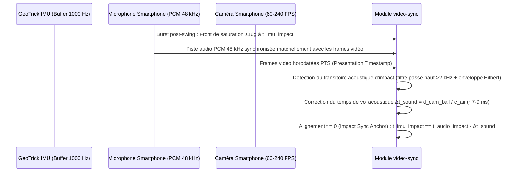

# 02 — Acquisition Vidéo Smartphone, Calibration Spatiale & Synchronisation Milliseconde (`video-sync`)

- **Statut :** Normatif (Phase 1 — SDD)
- **Version :** 1.0.0
- **Modules cibles :** `src/video-sync` (TypeScript / Node.js + Workers Vision Python) & `src/client-app`
- **Schéma associé :** [video-sync-session.schema.json](../schemas/video-sync-session.schema.json)
- **ADRs liés :** [ADR-0001](../docs/adr/0001-sdd-normative-ears-and-json-schema.md), [ADR-0003](../docs/adr/0003-single-smartphone-v1-and-16g-impact-signature.md)

---

## 1. Topologie de Capture Vidéo : Mono-Smartphone v1 (`Single-Camera Session`) & Extensibilité v2

### 1.1 Sélection du Mode d'Angle en v1
Dans la version 1, Kinetra opère avec **un seul smartphone (`Single-Camera Session`)** monté sur trépied et connecté directement en BLE au capteur GeoTrick IMU. Avant de démarrer la session, l'utilisateur sélectionne l'un des deux modes d'acquisition :

| Mode de Capture v1 | Positionnement du Smartphone | Métriques Extraits par Vision IA | Mode de Calcul Balistique |
| :--- | :--- | :--- | :--- |
| **`dtl` (*Down-The-Line* — Par défaut)** | Placé à $2.2\text{–}3.0\text{ m}$ derrière le joueur, à hauteur des mains ($\sim 0.9\text{–}1.1\text{ m}$), aligné parallèlement à la ligne de cible $+\vec{X}_w$. | Plan de swing 2D/3D, posture à l'adresse, trajectoire du club ET **fenêtre de départ de balle (`DTL Launch Window`)** sur les 3 à 5 premières frames post-impact (vitesse et angle de lancement vertical $\theta_{\text{launch}}$). | **Fusion Hybride IMU + Vidéo DTL** (`REQ-BAL-001`). |
| **`face_on` (*Face-On*)** | Placé à $2.2\text{–}3.0\text{ m}$ face au buste du joueur, perpendiculairement à la ligne de cible (axe $+\vec{Y}_w$). | Cinématique corporelle complète (rotation hanches/épaules *X-Factor*, inclinaison colonne, transfert de poids, *sway/slide* latéral, *lag* des poignets). | **100 % Cinématique IMU compensée + Impact Acoustique** (`REQ-BAL-002`). |

### 1.2 Extensibilité Native vers le Mode Bi-Caméra v2 (`dual_camera`)
Le contrat formel `video-sync-session.schema.json` modélise les flux vidéo sous la forme d'une collection `camera_streams[]` (`minItems: 1`, `maxItems: 2`). En v1, `camera_streams` contient un seul élément (`role: "dtl"` ou `role: "face_on"`). En v2, l'ajout d'un second smartphone (`Companion Camera`) peuple simplement le second élément du tableau sans aucune rupture de contrat.

---

## 2. Calibration Spatiale Guidée (`Spatial Calibration Frame`)

Avant l'enregistrement du premier swing d'une session, `client-app` impose une étape de calibration géométrique assistée en réalité augmentée :

1. **Niveau à bulle virtuel (Alignement Gravitaire Camera Roll/Pitch)** :
   À partir des capteurs inertiels internes du smartphone, l'interface affiche un niveau à bulle virtuel et verrouille la validation lorsque :
   - Le roulis caméra (*roll*) vérifie $|\phi_{\text{cam}}| \le 1.0^\circ$.
   - Le tangage caméra (*pitch*) vérifie $|\theta_{\text{cam}}| \le 3.0^\circ$.
2. **Gabarit Visuel au Sol (Ligne de Cible $+\vec{X}_w$ & Position de Balle $O_{\text{ball}}$)** :
   L'écran superpose un gabarit de visée (ligne de jeu + zone de balle + silhouette joueur) que l'utilisateur aligne sur son tapis ou sur deux repères au sol (ex. baguette d'alignement ou deux balles espacées d'une longueur de club connue $L_{\text{club}}$ servant d'étalon métrique pixel $\leftrightarrow$ mètre).
3. **Calcul de la Matrice d'Homographie & Extrinsèques Caméra** :
   Le système enregistre la matrice de projection intrinsèque/extrinsèque $P_{\text{cam}} = K [R_{\text{cam}} \mid \vec{t}_{\text{cam}}]$ dans le `Spatial Calibration Frame`.

---

## 3. Synchronisation Milliseconde (`Impact Sync Anchor`, $t = 0$)

### 3.1 Problème Physique
Même lorsque le smartphone héberge à la fois la caméra ($60\text{ à }240\text{ FPS}$, soit une période inter-trame de $16.67\text{ ms}$ à $4.17\text{ ms}$) et la réception BLE du capteur GeoTrick IMU ($1000\text{ Hz}$ en buffer burst), il existe un décalage variable ($15\text{ à }120\text{ ms}$) entre l'horloge interne du microcontrôleur IMU et les timestamps des frames vidéo du pipeline matériel Android/iOS.

### 3.2 Algorithme d'Alignement sur l'`Impact Sync Anchor` ($\le \pm 2\text{ ms}$)

1. **En frappe réelle (`ball_strike`) — Alignement Acousto-Inertiel** :
   - Sur le flux IMU $1000\text{ Hz}$, l'instant d'impact $t_{\text{imu,impact}}$ est donné à $\pm 0.5\text{ ms}$ près par le front de saturation à $\pm 16\,g$ corrigé du temps de propagation dans le shaft $\Delta t_{\text{wave}}$.
   - Sur la piste audio PCM ($48\text{ kHz}$, attachée matériellement à l'horloge des frames vidéo du smartphone), `video-sync` isole le transitoire acoustique d'impact $t_{\text{audio,peak}}$ par filtrage passe-bande ($2.5\text{ kHz} - 12\text{ kHz}$) et détection de front par rapport d'énergie court-terme/long-terme (STA/LTA).
   - Le temps de propagation acoustique dans l'air entre la balle et le microphone du smartphone (situé à la distance calibrée $d_{\text{cam}}\in [2.0, 3.5]\text{ m}$) est retranché :
     $$t_{\text{video,impact}} = t_{\text{audio,peak}} - \frac{d_{\text{cam}}}{c_{\text{air}}(T_{\text{amb}})} \quad \text{avec} \quad c_{\text{air}} \approx 343\text{ m/s}$$
   - L'offset d'alignement global $\Delta t_{\text{sync}} = t_{\text{video,impact}} - t_{\text{imu,impact}}$ cale les deux chronologies sur $t = 0$ (**`Impact Sync Anchor`**) avec une précision $\le \pm 2.0\text{ ms}$.
   - **Option Flash Optique (`optical_flash_marker`)** : lorsque l'environnement est très bruyant (ex. practice couvert avec frappes voisines simultanées), le flash LED ou lacorrélation cinématique du passage de la tête de club dans la zone de balle valide la fenêtre de recherche acoustique à $\pm 16\text{ ms}$ autour de la frame d'impact visuelle.

2. **En mode Swing à Vide (`dry_swing`) — Alignement Cinématique par *Low Point*** :
   - En l'absence de choc sur une balle, `video-sync` aligne l'instant où la tête de club (ou les mains) franchit la verticale de la zone d'adresse sur l'image avec l'instant du pic de vitesse angulaire $\|\vec{\omega}(t)\|$ du capteur IMU (et, s'il y a brossage du tapis, avec le transitoire sonore de frottement).

---

## 4. Exigences Normatives (`REQ-SYNC-*`)

### `REQ-SYNC-001` — Fréquence Vidéo Minimale & Exposition Courte
> **While** l'enregistrement vidéo d'un swing est actif, **the system shall** capturer le flux à une cadence minimale de $60\text{ FPS}$ ($120\text{ ou }240\text{ FPS}$ recommandés lorsque le capteur optique du smartphone le supporte) avec une durée d'exposition par trame (*shutter speed*) $\le \frac{1}{1000}\text{ s}$ en extérieur afin de limiter le flou cinétique du club et de la balle.

### `REQ-SYNC-002` — Validation de la Calibration Spatiale Guidée
> **When** l'utilisateur initialise une session de capture, **the system shall** bloquer le passage à l'état `READY_FOR_SWING` tant que le niveau à bulle virtuel dépasse $|\text{roll}| > 1.0^\circ$ ou $|\text{pitch}| > 3.0^\circ$ ou que les repères visuels de ligne de cible et de position de balle ne sont pas validés dans le `Spatial Calibration Frame`.

### `REQ-SYNC-003` — Synchronisation Acousto-Inertielle Milliseconde
> **When** un swing de type `ball_strike` est capturé, **the system shall** aligner la chronologie IMU ($1000\text{ Hz}$) et la chronologie vidéo/audio du smartphone sur l'`Impact Sync Anchor` ($t = 0$) en corrigeant le temps de vol acoustique $d_{\text{cam}}/c_{\text{air}}$, avec une erreur résiduelle maximale de $\pm 2.0\text{ ms}$.

### `REQ-SYNC-004` — Repli de Synchronisation en Mode `Dry Swing`
> **If** le swing est classifié comme `dry_swing` (absence de saturation $\pm 16\,g$ et de pic acoustique de frappe de balle), **then the system shall** synchroniser la chronologie vidéo et la chronologie IMU par corrélation croisée entre le passage visuel du club au point bas (*Low Point*) et le maximum de vitesse angulaire IMU, avec une tolérance $\le \pm 8.0\text{ ms}$.

### `REQ-SYNC-005` — Extraction de la Fenêtre de Départ DTL (`DTL Launch Window`)
> **Where** la session est configurée en mode `dtl`, **when** un événement `ball_strike` survient à $t = 0$, **the system shall** détecter le centroïde de la balle sur les frames comprises dans $[0\text{ ms}, +60\text{ ms}]$ pour estimer l'angle de lancement vertical $\theta_{\text{launch,video}}$, la direction azimutale initiale $\phi_{\text{launch,video}}$ et un score de visibilité `launch_visibility_confidence` $\in [0, 1]$.

### `REQ-SYNC-006` — Extraction Cinématique Corporelle 2D/3D (Pose Estimation)
> **When** une séquence vidéo synchronisée est traitée, **the system shall** extraire à chaque frame les 33 points clés squelettiques normalisés (format MediaPipe Pose 3D) exprimés dans $\mathcal{R}_{\text{world}}$ ainsi que les angles biomécaniques clés (rotation épaules, rotation hanches, *X-Factor*, inclinaison latérale et angle du plan de swing).
