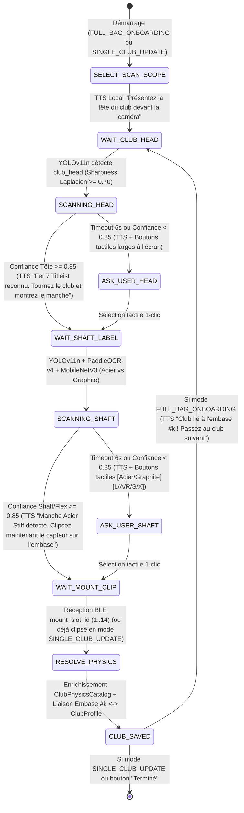

# 03 — Initialisation Interactive du Sac, Appairage des Embases Auto-ID & Mise à Jour Unitaire (`bag-scanner`)

- **Statut :** Normatif (Phase 1 — SDD)
- **Version :** 1.1.0
- **Modules cibles :** `src/bag-scanner` (Python 3.11+ : Vision / OCR / Catalogue) & `src/client-app` (Synthèse Vocale TTS, Flux Caméra & Récepteur BLE `mount_slot_id`)
- **Schémas associés :** [bag-scanner.schema.json](../schemas/bag-scanner.schema.json), [club-profile.schema.json](../schemas/club-profile.schema.json)
- **ADR lié :** [ADR-0004](../docs/adr/0004-xiao-nrf52840-sense-gpio-mount-id-and-ulp-wake.md)

---

## 1. Expérience Utilisateur : Guidage Vocal Naturel On-Device (`Sherpa-ONNX` + `Piper / Kokoro TTS`) & Reconnaissance Vidéo Continue

En v1, le module **`bag-scanner`** privilégie la simplicité et la fiabilité sur le terrain : **il ne nécessite pas de reconnaissance vocale (STT)**, mais guide le joueur par **des indications vocales naturelles générées 100 % en local sur le téléphone** (le même moteur vocal `VocalCoachService` étant réutilisé pendant l'entraînement pour donner des conseils après chaque swing) :

- **Moteur de Synthèse Vocale Neuronale Locale (`Sherpa-ONNX` C++ JSI)** :
  - Modèle par défaut : **`Piper Neural TTS` — voix française `fr_FR-siwis-medium` (ou `fr_FR-upmc-medium`)** en format ONNX `int8` ($\sim 35\text{ Mo}$, latence $< 40\text{ ms}$ sur CPU ARM64, zéro connexion Internet).
  - Modèle haute-fidélité interchangeable en configuration : **`Kokoro-82M` (`ff_siwis`)** ($\sim 85\text{ Mo}$).
  - Architecture **Hybride Cache + Synthèse Dynamique** : les consignes récurrentes (*"Présentez la tête du club devant la caméra"*, *"Tournez maintenant le club pour montrer le manche"*, *"Clipsez le capteur en haut du grip"*) sont pré-cachées en mémoire ($0\text{ ms}$ de latence), tandis que les annonces spécifiques (*"Fer 7 Titleist T100 en acier Stiff associé à l'embase numéro 7"*) sont synthétisées à la volée avec la même voix.
- **Flux Vidéo Continu ($30\text{ FPS}$, $\ge 1080\text{p}$) & Fallback Tactile Rapide** :
  - Dès que le score de confiance franchit $\ge 0.85$, la machine à états passe toute seule à l'étape suivante avec un bip de validation et une annonce vocale.
  - Si une étiquette est trop usée (`confidence < 0.85` après $6\text{ s}$), la voix l'indique et l'écran affiche **de larges boutons tactiles à 1 clic** (ex. `[Acier]` / `[Graphite]` et `[R]` / `[S]`) sans obliger le joueur à taper au clavier ni à parler dans le bruit d'un practice.

---

## 2. Les 3 Micro-Modèles de Vision Embarqués (On-Device `LiteRT / ONNX`, $< 15\text{ Mo}$ au total)

Pour garantir une exécution fluide directement sur le smartphone (Android & iOS) sans serveur distant, l'analyse vidéo du `bag-scanner` repose sur 3 modèles quantifiés `int8` complémentaires :

| Ordre | Modèle Embarqué (On-Device) | Taille | Rôle précis dans le pipeline `bag-scanner` |
| :--- | :--- | :--- | :--- |
| **1. Détecteur & Cadreur** | **`YOLOv11n` (`int8` TFLite / ONNX)** | $\sim 3.2\text{ Mo}$ | Tourne à $30\text{ FPS}$ pour isoler les boîtes englobantes `club_head`, `shaft_tube` et `shaft_label`, et calculer la netteté par variance du Laplacien (`sharpness_score >= 0.70`) uniquement sur le club avant de lancer l'OCR. |
| **2. Lecteur OCR** | **`PaddleOCR-v4 Mobile` (ONNX `int8`) + `ML Kit / Apple Vision`** | $\sim 8.0\text{ Mo}$ | Lit les textes longitudinaux sur tubes cylindriques (`"Dynamic Gold S300"`, `"Ventus 5-R"`, `"Alta CB"`) et les gravures métalliques sur la tête (`"7"`, `"56°"`, `"9.5°"`, `"Titleist T100"`). |
| **3. Classifieur Matériau** | **`MobileNetV3-Small` (`int8`) + Analyse de Spécularité** | $\sim 2.5\text{ Mo}$ | Distingue visuellement un manche **`steel`** (reflets métalliques chromés à fort gradient spéculaire et paliers *steps*) d'un manche **`graphite`** (réflexion diffuse mate/satinée ou trame carbone), même si l'inscription imprimée est effacée. |

### Étape 1 — Reconnaissance de la Tête de Club (`Head Inspection Stage`)
- `YOLOv11n` + `PaddleOCR-v4` identifient la catégorie (`driver`, `fairway_wood`, `hybrid`, `iron`, `wedge`, `putter`), la latéralité (`right_handed` / `left_handed`), la marque, le modèle et le numéro/loft gravé.

### Étape 2 — Reconnaissance du Shaft & Matériau (`Shaft Inspection Stage`)
- Fusion du classifieur optique `MobileNetV3-Small` (`steel` vs `graphite`) et de l'OCR `PaddleOCR-v4` pour extraire le modèle de manche et normaliser le `flex_rating` (`L`, `A`, `R`, `S`, `X`).

### Étape 3 — Appairage Matériel de l'Embase (`Mount Slot Binding Stage`)
- Si le capteur n'est pas encore clipsé sur le club en cours de scan, l'assistant vocal demande : *"Clipsez maintenant le capteur en haut du grip de ce club"*.
- Dès l'insertion dans la `Keyed Butt-Cap Mount`, le XIAO BLE nRF52840 Sense se réveille par interruption `GPIOTE`, lit les 4 broches `D0..D3` (`mount_slot_id` $\in [1..14]$) et transmet l'événement BLE au smartphone.
- Si ce `mount_slot_id` était déjà associé à un ancien club dans le sac :
  - En mode `SINGLE_CLUB_UPDATE`, il remplace l'ancien profil de cette embase après confirmation vocale (*"L'embase numéro 1 passe du TaylorMade Qi10 au Ping G430"*).
  - En mode `FULL_BAG_ONBOARDING`, il avertit l'utilisateur en cas de doublon d'embase.

### Étape 4 — Résolution Mécanique via `ClubPhysicsCatalog`
Le module `bag-scanner` enrichit automatiquement le profil avec les constantes mécaniques normalisées ($L_{\text{club}}$, $d_{\text{hands}}$, $m_{\text{head}}$, $\vec{e}_{\text{cg}}$, $EI_{\text{eff}}$, $GJ_{\text{eff}}$, $\kappa_{\text{aniso}}$, vitesse d'onde $c_{\text{shaft}}$) issues de `ClubPhysicsCatalog` et enregistre le `Club Profile` lié à `mount_slot_id`.

---

## 3. Exigences Normatives (`REQ-BAG-*`)

### `REQ-BAG-001` — Guidage Vocal Interactif (TTS) par Machine à États
> **When** l'utilisateur démarre le parcours `bag-scanner` (en mode `FULL_BAG_ONBOARDING` ou `SINGLE_CLUB_UPDATE`), **the system shall** émettre des consignes vocales (TTS) synchronisées avec l'état d'inspection vidéo (`WAIT_CLUB_HEAD` $\rightarrow$ `WAIT_SHAFT_LABEL` $\rightarrow$ `WAIT_MOUNT_CLIP` $\rightarrow$ `CLUB_SAVED`).

### `REQ-BAG-002` — Sélection Automatique des Meilleures Frames Vidéo (Anti-Flou)
> **While** le flux vidéo d'inspection d'un club est actif, **the system shall** évaluer la netteté de chaque frame par variance du Laplacien dans la boîte englobante du club et n'exécuter l'inférence OCR/Vision que sur les frames dépassant `sharpness_score >= 0.70`.

### `REQ-BAG-003` — Extraction Structurée & Score de Confiance
> **When** `bag-scanner` analyse une séquence vidéo de tête et de shaft, **the system shall** produire un objet conforme à `bag-scanner.schema.json` contenant `club_category`, `club_label`, `brand`, `model`, `shaft_material` (`steel` ou `graphite`), `flex_rating` (`L`, `A`, `R`, `S`, `X`) ainsi qu'un score de confiance individuel $\in [0, 1]$.

### `REQ-BAG-004` — Dialogue de Fallback sur Confiance Insuffisante ($< 0.85$)
> **If** le score de confiance sur `shaft_material`, `flex_rating` ou `club_label` reste strictement inférieur à $0.85$ après $6.0\text{ s}$ d'exposition vidéo, **then the system shall** formuler une question vocale explicite (et afficher des boutons larges à l'écran) demandant à l'utilisateur de confirmer l'attribut manquant.

### `REQ-BAG-005` — Enrichissement Mécanique Complet via `ClubPhysicsCatalog`
> **When** les attributs d'un club sont validés, **the system shall** enrichir le `Club Profile` avec les paramètres mécaniques complets ($L_{\text{club}}$, $d_{\text{hands}}$, $m_{\text{head}}$, $\vec{e}_{\text{cg}}$, $EI_{\text{eff}}$, $GJ_{\text{eff}}$, $\kappa_{\text{aniso}}$) issus de `ClubPhysicsCatalog`.

### `REQ-BAG-006` — Association Automatique `mount_slot_id` (`1..14`) par Clipsage du Capteur
> **When** le capteur GeoTrick IMU est clipsé sur l'embase du club pendant ou au début du scan, **the system shall** lire le `mount_slot_id` ($\in [1..14]$) transmis en BLE et l'enregistrer dans `butt_cap_mount.mount_slot_id` du `Club Profile` afin que toute insertion ultérieure du capteur sur cette embase sélectionne ce club automatiquement.

### `REQ-BAG-007` — Mise à Jour Unitaire d'un Club Après Coup (`SINGLE_CLUB_UPDATE`)
> **When** l'utilisateur invoque le mode `SINGLE_CLUB_UPDATE` (ou clipse le capteur sur une embase et demande la modification de ce club), **the system shall** exécuter le flux d'assistance vocale et vidéo uniquement pour ce club et mettre à jour l'entrée correspondante du sac sans modifier ni rescanner les autres clubs enregistrés.
