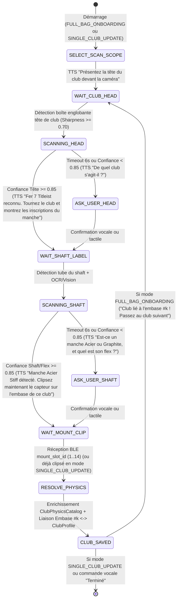

# 03 — Initialisation Interactive du Sac, Appairage des Embases Auto-ID & Mise à Jour Unitaire (`bag-scanner`)

- **Statut :** Normatif (Phase 1 — SDD)
- **Version :** 1.1.0
- **Modules cibles :** `src/bag-scanner` (Python 3.11+ : Vision / OCR / Catalogue) & `src/client-app` (Synthèse Vocale TTS, Flux Caméra & Récepteur BLE `mount_slot_id`)
- **Schémas associés :** [bag-scanner.schema.json](../schemas/bag-scanner.schema.json), [club-profile.schema.json](../schemas/club-profile.schema.json)
- **ADR lié :** [ADR-0004](../docs/adr/0004-xiao-nrf52840-sense-gpio-mount-id-and-ulp-wake.md)

---

## 1. Deux Modes d'Exécution : Scan Complet du Sac (`FULL_BAG_ONBOARDING`) & Mise à Jour Unitaire d'un Club (`SINGLE_CLUB_UPDATE`)

Le module **`bag-scanner`** supporte deux modes d'invocation utilisant **exactement le même assistant interactif vocal (TTS) et vidéo en continu** :

1. **Mode Initialisation Complète (`FULL_BAG_ONBOARDING`)** :
   Lors de la première configuration du sac, le joueur présente ses clubs l'un après l'autre devant la caméra et clipse le capteur sur l'embase de chaque club pour associer son `mount_slot_id` (`1..14`).
2. **Mode Mise à Jour Unitaire Après Coup (`SINGLE_CLUB_UPDATE`)** :
   Lorsqu'un joueur change un club dans son sac (ex. achat d'un nouveau Driver ou remplacement d'un Wedge), change de shaft, ou souhaite réassigner une embase **sans refaire tout son sac** :
   - Il clipse simplement le capteur GeoTrick sur l'embase du club à modifier (ou sélectionne *"Modifier un club"*).
   - Le capteur se réveille (`Wake-on-Use`), lit le `mount_slot_id` (ex. `Embase #1`) et l'envoie en BLE.
   - L'assistant vocal démarre directement sur ce seul emplacement : *"Mise à jour du club sur l'embase numéro 1. Présentez la tête du nouveau club devant la caméra…"* puis met à jour uniquement ce `Club Profile` et se termine immédiatement !

---

## 2. Pipeline d'Extraction Vision, OCR & Appairage d'Embase en 4 Étapes

### Étape 1 — Reconnaissance de la Tête de Club (`Head Inspection Stage`)
- Identification de la catégorie (`driver`, `fairway_wood`, `hybrid`, `iron`, `wedge`, `putter`), de la latéralité (`right_handed` / `left_handed`), de la marque, du modèle et du numéro/loft gravé.

### Étape 2 — Reconnaissance du Shaft & Matériau (`Shaft Inspection Stage`)
- Classification visuelle de surface (`steel` vs `graphite`) + OCR des inscriptions du manche et normalisation du `flex_rating` (`L`, `A`, `R`, `S`, `X`).

### Étape 3 — Appairage Matériel de l'Embase (`Mount Slot Binding Stage`)
- Si le capteur n'est pas encore clipsé sur le club en cours de scan, l'assistant vocal demande : *"Clipsez maintenant le capteur en haut du grip de ce club"*.
- Dès l'insertion dans la `Keyed Butt-Cap Mount`, le XIAO BLE nRF52840 Sense se réveille par interruption `GPIOTE`, lit les 4 broches `D0..D3` (`mount_slot_id` $\in [1..14]$) et transmet l'événement BLE au smartphone.
- Si ce `mount_slot_id` était déjà associé à un ancien club dans le sac :
  - En mode `SINGLE_CLUB_UPDATE`, il remplace l'ancien profil de cette embase après confirmation vocale (*"L'embase numéro 1 passe du TaylorMade Qi10 au Ping G430"*).
  - En mode `FULL_BAG_ONBOARDING`, il avertit l'utilisateur en cas de doublon d'embase.

### Étape 4 — Résolution Mécanique via `ClubPhysicsCatalog`
Le module `bag-scanner` enrichit automatiquement le profil avec les constantes mécaniques normalisées ($L_{\text{club}}$, $d_{\text{hands}}$, $m_{\text{head}}$, $\vec{e}_{\text{cg}}$, $EI_{\text{eff}}$, $GJ_{\text{eff}}$, $\kappa_{\text{aniso}}$, vitesse d'onde $c_{\text{shaft}}$) issues de `ClubPhysicsCatalog` et enregistre le `Club Profile` lié à `mount_slot_id`.

---

## 3. Exigences Normatives (`REQ-BAG-*`)

### `REQ-BAG-001` — Guidage Vocal Interactif (TTS) par Machine à États
> **When** l'utilisateur démarre le parcours `bag-scanner` (en mode `FULL_BAG_ONBOARDING` ou `SINGLE_CLUB_UPDATE`), **the system shall** émettre des consignes vocales (TTS) synchronisées avec l'état d'inspection vidéo (`WAIT_CLUB_HEAD` $\rightarrow$ `WAIT_SHAFT_LABEL` $\rightarrow$ `WAIT_MOUNT_CLIP` $\rightarrow$ `CLUB_SAVED`).

### `REQ-BAG-002` — Sélection Automatique des Meilleures Frames Vidéo (Anti-Flou)
> **While** le flux vidéo d'inspection d'un club est actif, **the system shall** évaluer la netteté de chaque frame par variance du Laplacien dans la boîte englobante du club et n'exécuter l'inférence OCR/Vision que sur les frames dépassant `sharpness_score >= 0.70`.

### `REQ-BAG-003` — Extraction Structurée & Score de Confiance
> **When** `bag-scanner` analyse une séquence vidéo de tête et de shaft, **the system shall** produire un objet conforme à `bag-scanner.schema.json` contenant `club_category`, `club_label`, `brand`, `model`, `shaft_material` (`steel` ou `graphite`), `flex_rating` (`L`, `A`, `R`, `S`, `X`) ainsi qu'un score de confiance individuel $\in [0, 1]$.

### `REQ-BAG-004` — Dialogue de Fallback sur Confiance Insuffisante ($< 0.85$)
> **If** le score de confiance sur `shaft_material`, `flex_rating` ou `club_label` reste strictement inférieur à $0.85$ après $6.0\text{ s}$ d'exposition vidéo, **then the system shall** formuler une question vocale explicite (et afficher des boutons larges à l'écran) demandant à l'utilisateur de confirmer l'attribut manquant.

### `REQ-BAG-005` — Enrichissement Mécanique Complet via `ClubPhysicsCatalog`
> **When** les attributs d'un club sont validés, **the system shall** enrichir le `Club Profile` avec les paramètres mécaniques complets ($L_{\text{club}}$, $d_{\text{hands}}$, $m_{\text{head}}$, $\vec{e}_{\text{cg}}$, $EI_{\text{eff}}$, $GJ_{\text{eff}}$, $\kappa_{\text{aniso}}$) issus de `ClubPhysicsCatalog`.

### `REQ-BAG-006` — Association Automatique `mount_slot_id` (`1..14`) par Clipsage du Capteur
> **When** le capteur GeoTrick IMU est clipsé sur l'embase du club pendant ou au début du scan, **the system shall** lire le `mount_slot_id` ($\in [1..14]$) transmis en BLE et l'enregistrer dans `butt_cap_mount.mount_slot_id` du `Club Profile` afin que toute insertion ultérieure du capteur sur cette embase sélectionne ce club automatiquement.

### `REQ-BAG-007` — Mise à Jour Unitaire d'un Club Après Coup (`SINGLE_CLUB_UPDATE`)
> **When** l'utilisateur invoque le mode `SINGLE_CLUB_UPDATE` (ou clipse le capteur sur une embase et demande la modification de ce club), **the system shall** exécuter le flux d'assistance vocale et vidéo uniquement pour ce club et mettre à jour l'entrée correspondante du sac sans modifier ni rescanner les autres clubs enregistrés.
