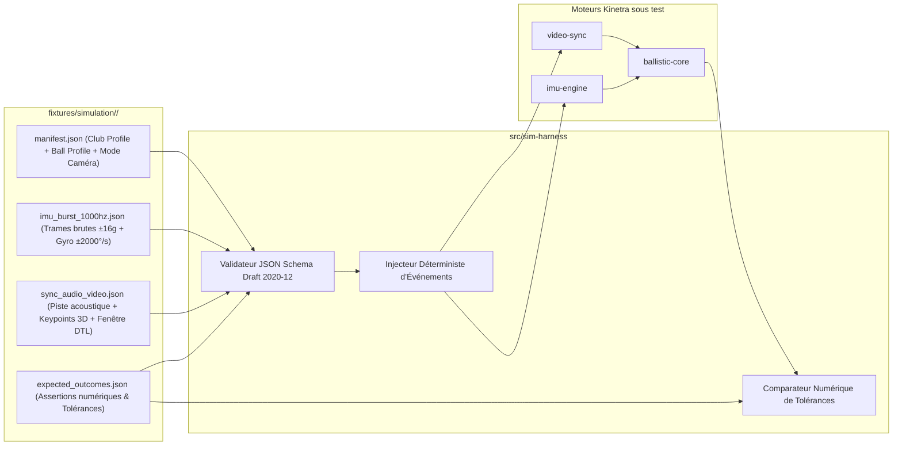

# 05 — Harnais de Simulation Déterministe & Scénarios CI/CD (`sim-harness`)

- **Statut :** Normatif (Phase 1 — SDD)
- **Version :** 1.0.0
- **Module cible :** `src/sim-harness`
- **Schéma associé :** [simulation-fixture.schema.json](../schemas/simulation-fixture.schema.json)
- **Répertoire des datasets :** `fixtures/simulation/`

---

## 1. Objectif & Architecture du Mode Replay Déterministe

Le module **`sim-harness`** garantit que l'ensemble de la chaîne algorithmique (`imu-engine`, `video-sync`, `bag-scanner`, `ballistic-core`) peut être développé, testé et validé en intégration continue (CI/CD) **sans capteur BLE physique GeoTrick ni smartphone connecté**.

---

## 2. Structure Normative d'une Fixture de Simulation

Chaque répertoire `fixtures/simulation/<scenario-id>/` doit contenir quatre fichiers JSON strictement conformes aux schémas de `schemas/` :

1. **`manifest.json`** :
   - Identifiant du scénario (`scenario_id`), description et exigences `REQ-*` couvertes.
   - `club_profile` complet (conforme à `club-profile.schema.json`).
   - `ball_profile` complet (`tour_ball` ou `range_ball`, conforme à `ball-profile.schema.json`).
   - Configuration de session (`camera_mode`: `"dtl"` ou `"face_on"`, conditions atmosphériques : température, altitude, vent 3D).
2. **`imu_burst_1000hz.json`** :
   - Séquence temporelle de trames IMU brutes à $1000\text{ Hz}$ issues du sommet du grip (`Keyed Butt-Cap Mount`, $s = 0$), incluant la phase d'adresse immobile ($\ge 0.8\text{ s}$ pour tester la tare `REQ-IMU-001`), le *backswing*, le *downswing* (accélération centripète $10\text{–}14.5\,g < 16\,g$), et la signature d'impact (saturation à $\pm 16\,g$, saut de torsion gyroscopique $\Delta \omega_z$, et oscillation *ring-down* post-impact).
3. **`sync_audio_video.json`** :
   - Horodatages des frames vidéo ($60\text{ ou }120\text{ FPS}$), enveloppe acoustique avec pic d'impact à distance $d_{\text{cam}}$, trajectoire de départ de balle sur les premières frames (`DTL Launch Window` si mode `dtl`), et points clés squelettiques 3D.
4. **`expected_outcomes.json`** :
   - Valeurs de référence attendues et **tolérances maximales autorisées** pour chaque métrique de sortie.

---

## 3. Catalogue des 4 Scénarios Normatifs de Référence (`fixtures/simulation/`)

| ID Scénario | Équipement & Mode | Phénomènes Physiques Testés | Exigences Vérifiées |
| :--- | :--- | :--- | :--- |
| **`01-driver-graphite-regular-tour-ball`** | Driver $10.5^\circ$, Shaft **Graphite Regular (`R`)**, Balle **`tour_ball`** (Pro V1), Caméra **`dtl` ($120\text{ FPS}$)**, Frappe **Centrée (`center`)** | Forte flexion *lead/droop* et torsion anisotrope du shaft graphite ($+2.4^\circ$ dynamic loft, $-1.6^\circ$ twist), saturation $\pm 16\,g$ courte ($1.5\text{ ms}$), $\Delta \omega_z \approx 0$, fusion hybride IMU+DTL, vol Pro V1 complet. | `REQ-IMU-001`, `REQ-IMU-003`, `REQ-IMU-005`, `REQ-IMU-006`, `REQ-SYNC-003`, `REQ-BAL-001`, `REQ-BAL-004` |
| **`02-iron7-steel-stiff-range-ball`** | Fer 7 $32^\circ$, Shaft **Acier Stiff (`S`)**, Balle **`range_ball`** (Practice), Caméra **`dtl` ($60\text{ FPS}$)**, Frappe **Centrée (`center`)** | Rigidité de torsion élevée de l'acier ($|\text{twist}| < 0.4^\circ$), pénalité aérodynamique et COR de la balle de practice (`range_ball`) + calcul de `tour_ball_equivalent_carry_m`. | `REQ-IMU-006`, `REQ-BAL-003`, `REQ-BAL-004` |
| **`03-driver-dry-swing-no-ball`** | Driver $10.5^\circ$, Shaft **Graphite Stiff (`S`)**, **Sans balle (`Dry Swing`)**, Caméra **`dtl` ($60\text{ FPS}$)** | Accélération au sommet du grip culminant à $13.4\,g$ (**aucune saturation à $16\,g$**), absence de pic acoustique d'impact balle, synchronisation par *Low Point* cinématique, génération de trajectoire virtuelle (`is_virtual_ball: true`). | `REQ-IMU-004`, `REQ-SYNC-004`, `REQ-BAL-005` |
| **`04-single-face-on-toe-strike`** | Fer 7 $32^\circ$, Shaft **Graphite Regular (`R`)**, Balle **`tour_ball`**, Caméra **`face_on` ($60\text{ FPS}$)**, Frappe **en Pointe (`toe`, $y_{\text{impact}} = -14\text{ mm}$)** | Mode mono-caméra `face_on` (calcul balistique 100 % IMU sans fenêtre DTL), saturation $\pm 16\,g$ + fort saut gyroscopique axial d'ouverture ($\Delta \omega_z = -245^\circ/\text{s}$) + fort *ring-down* $\implies$ détection `toe` strike + *gear effect* / perte de *Smash Factor*. | `REQ-ARCH-001`, `REQ-IMU-005`, `REQ-BAL-002` |

---

## 4. Tolérances Numériques d'Acceptation en CI/CD

| Métrique Évaluée | Unité | Tolérance Maximale CI/CD |
| :--- | :--- | :--- |
| Offset de synchronisation `Impact Sync Anchor` ($\Delta t_{\text{sync}}$) | $\text{ms}$ | $\le \pm 1.5\text{ ms}$ (`ball_strike`) / $\le \pm 6.0\text{ ms}$ (`dry_swing`) |
| Vitesse tête de club compensée ($V_{\text{head}}$) | $\text{m/s}$ | $\le \pm 0.25\text{ m/s}$ |
| Angle de face compensé (`Compensated Clubface Orientation` $\theta_{\text{face,comp}}$) | $\text{deg}$ | $\le \pm 0.30^\circ$ |
| Loft dynamique compensé ($\theta_{\text{loft,comp}}$) | $\text{deg}$ | $\le \pm 0.40^\circ$ |
| Localisation horizontale d'impact ($y_{\text{impact}}$) | $\text{mm}$ | $\le \pm 3.5\text{ mm}$ (et classification `heel`/`center`/`toe` exacte à $100\%$) |
| Distance au point de chute (*Carry* $X_{\text{carry}}$) | $\text{m}$ | $\le \pm 0.50\text{ m}$ |
| Déviation latérale (*Lateral Offline* $Y_{\text{carry}}$) | $\text{m}$ | $\le \pm 0.35\text{ m}$ |

---

## 5. Exigences Normatives (`REQ-SIM-*`)

### `REQ-SIM-001` — Exécution 100 % Hors-Ligne et Sans Matériel
> **When** la suite de tests CI/CD invoque `sim-harness`, **the system shall** exécuter les 4 scénarios de `fixtures/simulation/` sans accès réseau, sans adaptateur Bluetooth matériel et sans périphérique caméra physique.

### `REQ-SIM-002` — Validation Préalable des Fixtures contre `schemas/`
> **Before** d'injecter un scénario de simulation dans les moteurs de calcul, **the system shall** valider tous les fichiers JSON du scénario contre `schemas/*.schema.json` et faire échouer le test immédiatement si une fixture viole le contrat de données.

### `REQ-SIM-003` — Vérification Automatique des Tolérances Numériques
> **When** un scénario de simulation termine son exécution, **the system shall** comparer chaque métrique de sortie aux bornes définies dans `expected_outcomes.json` et retourner un code de sortie non nul (`exit code != 0`) si une seule métrique excède sa tolérance.
